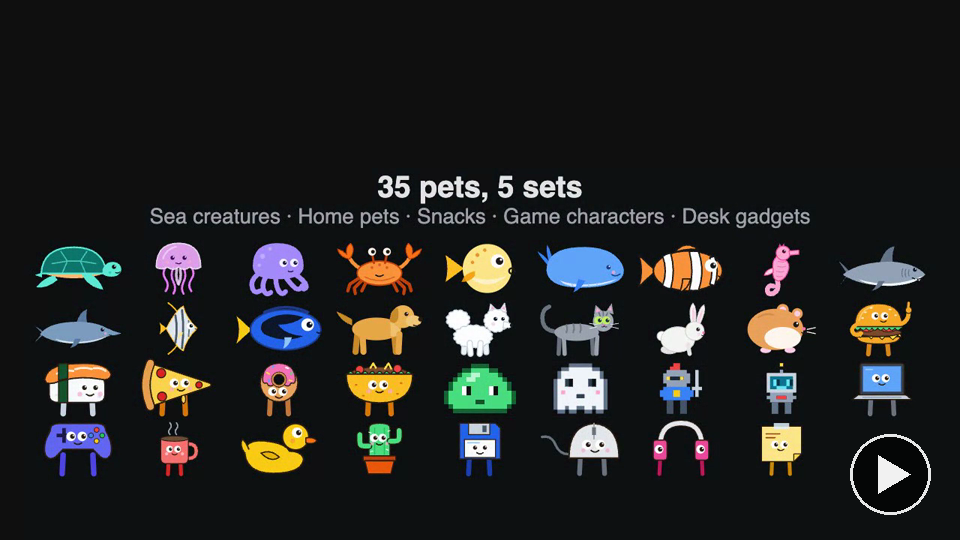
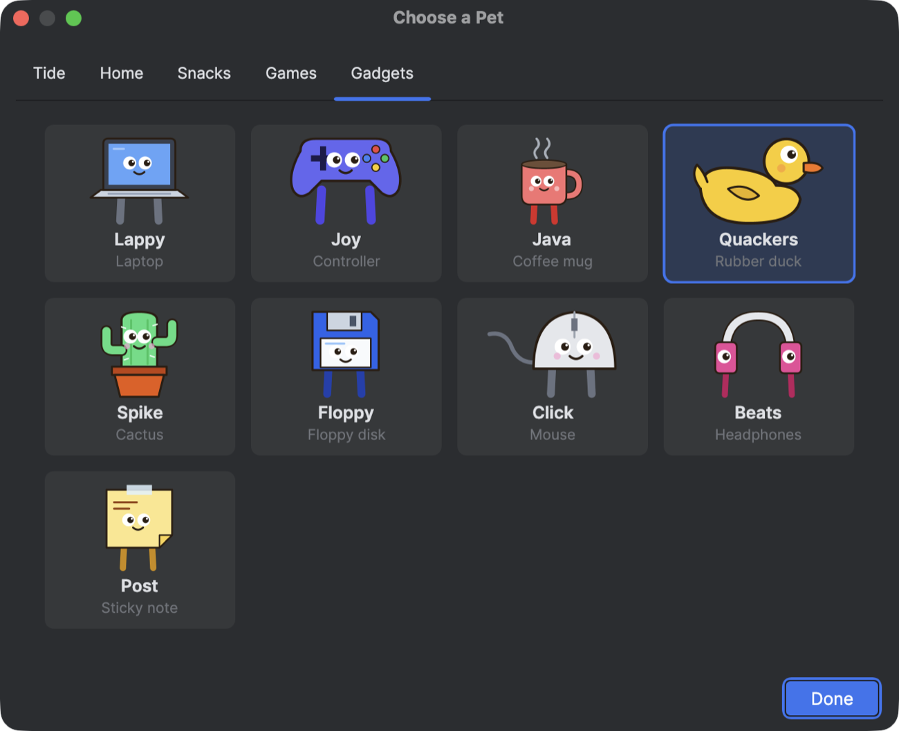
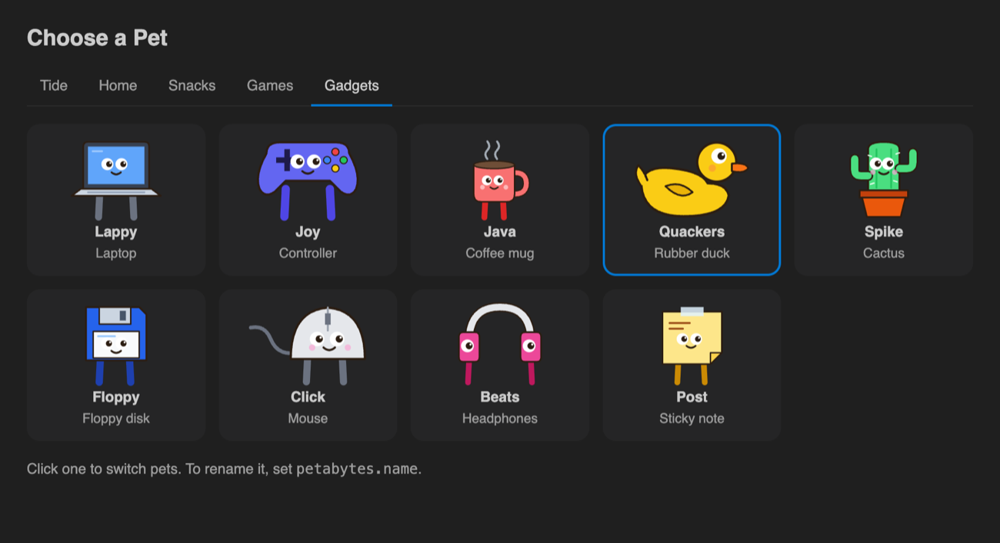

# Petabytes

Small companions with a big appetite. They keep you company while you code, in VS Code, JetBrains IDEs and on your Mac, and react to what you're doing. Pick one:

- **Tide**, sea creatures that swim: **Shelly** the sea turtle, **Bloop** the jellyfish, **Inky** the octopus, **Pinchy** the crab, **Puff** the pufferfish, **Blue** the whale, **Clem** the clownfish, **Sandy** the seahorse, **Finn** the shark, **Splash** the dolphin, **Angie** the angelfish or **Indigo** the blue tang.
- **Home**, pets that walk: **Biscuit** the golden retriever, **Loopee** the German Spitz, **Byte** the cat, **Clover** the bunny or **Nugget** the hamster.
- **Snacks**, food with feet: **Patty** the burger, **Nori** the sushi, **Pepe** the pizza, **Sprinkles** the donut or **Tuesday** the taco.
- **Games**, original pixel-art characters: **Squish** the slime, **Boo** the ghost, **Sir Pix** the knight or **Bolt** the robot. They say "+1 coin!" when you save, "LEVEL UP!" when you fix every error and "GAME OVER" when tests fail.
- **Gadgets**, the things on your desk: **Lappy** the laptop, **Joy** the controller, **Java** the coffee mug, **Quackers** the rubber duck (who helps when you debug), **Spike** the cactus, **Floppy** the floppy disk, **Click** the mouse, **Beats** the headphones or **Post** the sticky note.


[](docs/petabytes-video.mp4)

**▶ [Watch the 50-second video](docs/petabytes-video.mp4)**: the pets in your editor, then on your Mac.


## Which one do I need?

There are three, and they don't depend on each other:

- **In your editor**, to react to your code (saves, errors, tests, runs, debugging, commits): install the plugin in each IDE you use, the [VS Code extension](https://marketplace.visualstudio.com/items?itemName=chelayel.petabytes) or the [JetBrains plugin](https://plugins.jetbrains.com/plugin/35446-petabytes). The pet lives inside that IDE.
- **On your Mac desktop**, to react to your Mac (the app in front, typing, battery, Wi-Fi, downloads, screenshots): [the Mac app](#on-your-mac). It walks along your Dock, but it can't see your code; for that, add the editor plugin too.
- **On your Windows desktop**: [the Windows app](#on-windows), which walks along the top of your taskbar and reacts to the app in front, your battery and Claude Code.

## In your editor

| You | Your pet |
| --- | --- |
| Type | Swims faster |
| Save | Does a happy loop and blows bubbles |
| Add errors to the open file | Looks worried; hides when several appear at once (Inky inks, Puff puffs up) |
| Fix all the errors | Celebrates |
| Run a task or run configuration | Cheers when it passes, hides when it fails |
| Run the app | Spins: "It's alive!" |
| Debug | Brings out a magnifying glass |
| Open your AI assistant (Copilot, AI Assistant, Junie...), Copilot edits your code, or a big block of code appears at once | "Did an AI write that? I won't tell." |
| Claude Code reads, edits, runs tests, finishes (with the [add-on](#with-claude-code)) | Curious, excited, fingers crossed, "Done!" |
| Open the terminal; run `git push`, tests, installs, `rm -rf` (VS Code) | "Command line time!", "Ship it!", "Fingers crossed!", hides |
| Commit, switch branches | Celebrates, or notices the new branch |
| Undo several times in a row | "Rewinding time?" |
| Switch files | Looks around |
| Code late at night, early in the morning, or for hours | "It's late. The tide's out.", "Stretch break?" (Home pets say it their own way) |
| Pause for a moment | Now and then does something on its own: spins, hops, gets the zoomies, hums, blows bubbles, or wonders aloud ("Do bugs have bugs?"). Never in Low Power Mode, Power Save Mode or on a low battery |
| Step away for 3 minutes | Naps |
| Click it / double-click it | Does a spin / shows hearts |

**Feed it.** Use **Feed Pet** (the ♥ on the VS Code panel, or right-click the pet in IntelliJ) and a snack sinks down: `{ }`, `[ ]`, `( )`, `< >` or `;`. Your pet swims over and eats it. Every 20th `{` you type drops a crumb too, and a pet that hasn't eaten in an hour asks for one.


In IntelliJ IDEA, the pet swims up and down a strip at the editor's right edge, beside the scrollbar and out of the way of your code (or along the bottom edge, if you prefer):


In VS Code, the pet lives in a **Petabytes** panel in the Explorer:


In both editors, **Choose Pet** opens a picker with a tab per set (the IntelliJ one, then the VS Code one):





| Editor | Folder | Where the pet lives | Choose, show or hide |
| --- | --- | --- | --- |
| VS Code | [`vscode/`](vscode/) | A **Petabytes** panel in the Explorer (VS Code doesn't let extensions draw over the editor) | **Petabytes: Choose Pet** / **Toggle Pet**, or the `petabytes.*` settings |
| JetBrains (2024.2+) | [`intellij/`](intellij/) | Swimming up and down the editor's right edge, or along its bottom edge. Drag it to move it; it fades and lets clicks through when your cursor is right beside it | Right-click the pet or **Tools → Petabytes** → **Choose Pet…**; position, size and name in **Settings → Tools → Petabytes** |
| Claude Code | [`claude-code/`](claude-code/) | Drives the pets in the Mac app, VS Code and IntelliJ; optionally a small pixel-art pet above the prompt | `/pet`, `/pet on`, `/pet off` |
| Windows (10 and 11) | [`windows/`](windows/) | Walking along the top of the taskbar | Right-click the pet, or the tray icon |
| Mac (macOS 13+) | [`mac/`](mac/) | Standing on top of the Dock, or floating wherever you drag it; or, after **Move to Dock**, inside its own Dock icon | Right-click the pet, or the paw in the menu bar (the Dock icon, once moved there) |

## On your Mac

With [Homebrew](https://brew.sh):

```
brew install --cask chelayel/tap/petabytes
```

Or download `Petabytes-<version>.dmg` from the [latest release](https://github.com/Chelayel/petabytes/releases/latest) and drag Petabytes to Applications. It isn't notarized yet, so the first time, right-click it and choose **Open** (on recent macOS: try to open it, then **Open Anyway** in System Settings → Privacy & Security).

The pet walks along the top of your Dock, out of the way: clicks go through everywhere except on the pet itself. Drag it off the Dock to float it anywhere. **Move to Dock** puts it inside its own Dock icon instead, where you can keep it: it stays animated, a little bubble shows how it feels (z, !, ♥, ?) or that it's talking, and clicking the icon feeds it.

 

**Choose Pet…** opens a picker, a tab per set:


 It steps aside while an app is full screen (**Hide in Full Screen**, on by default).

It reacts to your Mac, and none of it asks for a permission:

| Your Mac | Your pet |
| --- | --- |
| You type, step away, come back, unlock | Gets excited, naps, wakes up, "Welcome back!" |
| You switch to a terminal, an editor, an AI app, a browser, chat, mail, a design or notes app, a calendar, a game, a video player, Docker, a database client, the simulator, Activity Monitor, a password manager... | "Command line time!", "Code time!", "Just one tab, right?", "Inbox zero?", "Careful with that DROP TABLE.", "*covers eyes*"... |
| Zoom, Teams or FaceTime | "A call? I'll be quiet." and hides |
| Battery low, plugged in | "Battery's low. Got a charger?", "Ahh, power." |
| Wi-Fi drops, comes back | Hides, then "We're back online!" |
| A download finishes, you take a screenshot, you copy something | "Download done!", "Cheese!", "Copy-paste? I saw nothing." |
| The Mac heats up, switches to dark mode | "It's getting hot in here.", "Lights out!" |

**With Claude Code**, the Mac pet also reacts to what Claude is doing: curious when it reads, excited when it edits, fingers crossed for tests and a cheer or a hide at the result, and "Done!" when it finishes. That comes from the Petabytes add-on for Claude Code, which tells the app on 127.0.0.1 only; **React to Claude Code** in the menu turns it off.

**Updates itself:** once a day it checks for a new release, and **Check for Updates…** in its menu asks right away. It installs an update only when the new app is signed with the same certificate, then relaunches.

It only ever learns *that* a key was pressed, never which, and *that* the clipboard changed, never what's on it. It draws at 20 frames a second (fewer while it sleeps, almost none while the screen is locked).

## On Windows

Download `Petabytes_<version>_x64-setup.exe` from the [latest release](https://github.com/Chelayel/petabytes/releases/latest) and run it; it installs for you alone, no administrator needed. It isn't code-signed yet, so Windows SmartScreen asks first: **More info**, then **Run anyway**.

The pet walks along the top of your taskbar; clicks go through everywhere except on the pet itself. Right-click it, or the tray icon, to feed it, choose a pet, change its size, or turn on **Open at Login**. It reacts to the app in front (terminals, editors, browsers, chat, games and more), says hello when you come back, warns when the battery runs low, steps aside while a game, a video or a presentation is full screen, and reacts to Claude Code like the Mac pet. On battery saver it draws fewer frames and skips its antics. It checks for a new version once a day and offers the installer.

It's [Tauri](https://tauri.app) around the same `web/pet.html` as VS Code, so it's small and uses Windows' own WebView2.

## With Claude Code

The Petabytes add-on for Claude Code ([`claude-code/`](claude-code/)) lets your pet react to what Claude does: curious when it reads files, excited when it edits code, fingers crossed for tests and a cheer or a hide at the result, and "Done!" when it finishes. It drives the pet in the Mac and Windows apps, at full size, and the pets in VS Code and IntelliJ; `/pet on` also puts a small pixel-art pet above the prompt. It tells the desktop app on 127.0.0.1, and leaves the latest event in `~/.petabytes/claude-code.json` for the editors; nothing leaves your computer. At a Claude Code prompt:

```
/plugin install petabytes --marketplace Chelayel/petabytes
```

## How it's built

Every pet is described once, in [`web/pets.json`](web/pets.json) (generated by [`tools/pets.py`](tools/pets.py)): shapes in a 120x80 box, grouped so each mood can pose a group, with parts that paddle, pulse or sway, and each pet's lines. Two small renderers draw it:

- **VS Code** ([`web/pet.html`](web/pet.html), hosted by [`vscode/extension.js`](vscode/extension.js)): SVG in a webview; the extension posts what you're doing.
- **JetBrains** ([`intellij/`](intellij/)): native Java2D in a layer over the editor (`pet/PetArt.kt`, `PetBrain.kt`, `PetPainter.kt`), fed by IDE listeners in `PetService.kt`.
- **Mac** ([`mac/`](mac/)): the same `web/pet.html` in a see-through, click-through panel (`PetWindow.swift`), fed by what the Mac reports in `Signals.swift`.

Adding a pet means adding it to `tools/pets.py`; every renderer picks it up (VS Code also lists it in `vscode/package.json` and `extension.js`). `./gradlew renderPreview` in `intellij/` draws every pet in every mood with the JetBrains painter, headlessly:


`python3 tools/gallery.py` redraws this README's pictures of the pets and their moods from `web/pet.html`, in headless Chrome.

Run locally:

```
python3 tools/pets.py > web/pets.json          # after changing the art
cd vscode && npx @vscode/vsce package           # petabytes-<version>.vsix
cd intellij && ./gradlew runIde                 # an IDE sandbox with the plugin
mac/build.sh && open mac/build/Petabytes.app    # the Mac app, and mac/build/Petabytes-<version>.dmg
cd windows && npx @tauri-apps/cli build         # the Windows app's installer (on Windows, with Rust)
```

## Support

Petabytes is free. If it makes you smile while you code, you can [buy me a coffee](https://buymeacoffee.com/chelayel) ☕

## License

MIT. Built by [Chelayel](https://www.chelayel.com).
